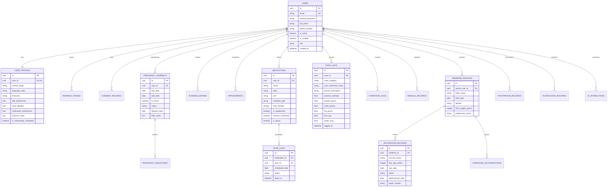

# MamAmie AI — Database Architecture & Schema Design

## 1. Executive Summary & Design Principles

The **MamAmie AI** database is architected for **high data privacy, obstetric safety, multi-stage maternal continuity, and sub-millisecond query performance**. It supports women across preconception planning, pregnancy (Weeks 1–42), postpartum recovery (4th trimester), and newborn immunization/care.

### Core Architectural Principles:
1. **Non-Guessable Primary Keys:** Every external entity uses UUIDv4 (`CHAR(36)` / `UUID`) to prevent ID enumeration attacks (OWASP API1:2023 Broken Object Level Authorization).
2. **Deterministic Timezones:** All timestamps are strictly persisted in UTC (`TIMESTAMP WITH TIME ZONE`). User timezone offsets are stored in `user_profiles.timezone` for localized calendar rendering.
3. **Multi-Stage Lifecycle Separation:** User records maintain seamless transitions from pregnancy to postpartum while preserving historical prenatal and delivery health records.
4. **Referential Integrity & Cascades:**
   * Dependent personal data (profiles, journals, dose logs, food diaries) employ `ON DELETE CASCADE` to guarantee full, irreversible erasure under DPDP Act 2023 / GDPR.
   * Newborn records are isolated in `newborn_profiles` with explicit caregiver access control lists (`caregiver_authorizations`), keeping pediatric records logically distinct from maternal records.
5. **Optimized Composite Indexing:** Every clinical query is indexed by `(user_id, scheduled_date)` or `(user_id, day_key)` to ensure $O(\log n)$ performance under millions of concurrent journal and reminder queries.

---

## 2. Entity-Relationship (ER) Diagram



---

## 3. Detailed Data Dictionary

### 3.1. Authentication & Privacy Domain

#### `users`
Core identity table containing credential hashes and account state.
| Column | Type | Constraints | Description |
| :--- | :--- | :--- | :--- |
| `id` | UUID / CHAR(36) | PRIMARY KEY | Unique user identifier. |
| `email` | VARCHAR(255) | UNIQUE, NOT NULL, INDEX | Primary login email address. |
| `hashed_password`| VARCHAR(255) | NOT NULL | UTF-8 salted bcrypt hash. |
| `full_name` | VARCHAR(255) | NOT NULL | User's preferred name. |
| `phone_number` | VARCHAR(32) | NULLABLE | Optional contact / SMS alert number. |
| `is_active` | BOOLEAN | NOT NULL, DEFAULT true | Account active state toggle. |
| `is_verified` | BOOLEAN | NOT NULL, DEFAULT false | Email/Phone verification status. |
| `role` | VARCHAR(32) | NOT NULL, DEFAULT 'user'| Access role (`user`, `clinician`, `admin`). |
| `created_at` | TIMESTAMP (UTC)| NOT NULL | Account registration timestamp. |
| `updated_at` | TIMESTAMP (UTC)| NOT NULL | Profile update timestamp. |

#### `refresh_tokens`
Rotating cryptographic refresh tokens supporting session revocation.
| Column | Type | Constraints | Description |
| :--- | :--- | :--- | :--- |
| `id` | UUID / CHAR(36) | PRIMARY KEY | Token identifier. |
| `user_id` | UUID / CHAR(36) | FOREIGN KEY -> `users.id` ON DELETE CASCADE | Associated user ID. |
| `token_hash` | VARCHAR(255) | UNIQUE, NOT NULL, INDEX | SHA-256 hash of refresh token. |
| `expires_at` | TIMESTAMP (UTC)| NOT NULL | Token expiration date (7 days). |
| `is_revoked` | BOOLEAN | NOT NULL, DEFAULT false | Revocation state on logout. |

#### `consent_records`
Immutable DPDP / GDPR consent ledger.
| Column | Type | Constraints | Description |
| :--- | :--- | :--- | :--- |
| `id` | UUID / CHAR(36) | PRIMARY KEY | Record identifier. |
| `user_id` | UUID / CHAR(36) | FOREIGN KEY -> `users.id` ON DELETE CASCADE | User granting consent. |
| `consent_type` | VARCHAR(64) | NOT NULL, INDEX | E.g., `health_data_processing`, `ai_assistant`. |
| `granted` | BOOLEAN | NOT NULL, DEFAULT true | Consent granted/withdrawn. |
| `notes` | TEXT | NULLABLE | Legal/consent revision terms reference. |

---

### 3.2. Maternal & Pregnancy Lifecycle Domain

#### `user_profiles`
Maternal health profile, preferences, and onboarding progress.
| Column | Type | Constraints | Description |
| :--- | :--- | :--- | :--- |
| `id` | UUID / CHAR(36) | PRIMARY KEY | Profile identifier. |
| `user_id` | UUID / CHAR(36) | FOREIGN KEY -> `users.id` ON DELETE CASCADE, UNIQUE | 1-to-1 link to user. |
| `current_stage` | VARCHAR(32) | NOT NULL, DEFAULT 'planning' | `planning`, `pregnant`, `postpartum`. |
| `language_code` | VARCHAR(10) | NOT NULL, DEFAULT 'en' | Preferred UI language (`en`, `hi`, `ta`, etc.). |
| `timezone` | VARCHAR(64) | NOT NULL, DEFAULT 'Asia/Kolkata' | IANA timezone for reminder scheduling. |
| `diet_preferences`| JSON / TEXT | NULLABLE | Dietary rules (vegetarian, vegan, diabetic). |
| `food_allergies` | JSON / TEXT | NULLABLE | Allergens (gluten, nuts, lactose, shellfish). |
| `notification_preferences` | JSON / TEXT | NULLABLE | Granular reminder toggles. |
| `clinician_notes` | TEXT | NULLABLE | User-transcribed doctor care guidelines. |
| `is_onboarding_completed` | BOOLEAN | NOT NULL, DEFAULT false | Onboarding completion flag. |

#### `pregnancy_journeys`
Active and historical gestational tracking records.
| Column | Type | Constraints | Description |
| :--- | :--- | :--- | :--- |
| `id` | UUID / CHAR(36) | PRIMARY KEY | Journey identifier. |
| `user_id` | UUID / CHAR(36) | FOREIGN KEY -> `users.id` ON DELETE CASCADE, INDEX | Associated mother. |
| `lmp_date` | DATE | NULLABLE | Last menstrual period date. |
| `edd_date` | DATE | NULLABLE | Ultrasound / clinician estimated due date. |
| `is_active` | BOOLEAN | NOT NULL, DEFAULT true | Current active pregnancy indicator. |
| `status` | VARCHAR(32) | NOT NULL, DEFAULT 'ongoing' | `ongoing`, `delivered`, `archived`. |
| `delivery_date` | DATE | NULLABLE | Actual childbirth delivery date. |
| `birth_notes` | TEXT | NULLABLE | Birth story and delivery notes. |

#### `pregnancy_milestones`
Gestational week achievements and developmental checklist items.
| Column | Type | Constraints | Description |
| :--- | :--- | :--- | :--- |
| `id` | UUID / CHAR(36) | PRIMARY KEY | Milestone identifier. |
| `journey_id` | UUID / CHAR(36) | FOREIGN KEY -> `pregnancy_journeys.id` ON DELETE CASCADE | Associated pregnancy. |
| `week_number` | INTEGER | NOT NULL, INDEX | Gestational week (1 to 42). |
| `title` | VARCHAR(255) | NOT NULL | E.g., "First Trimester Nuchal Translucency Scan". |
| `description` | TEXT | NULLABLE | Guidance notes. |
| `is_completed`| BOOLEAN | NOT NULL, DEFAULT false | Completion checkbox. |
| `completed_at`| TIMESTAMP (UTC)| NULLABLE | Completion timestamp. |

---

### 3.3. Daily Care, Nutrition, & Medications Domain

#### `planner_entries`
Unified calendar journal, tasks, symptoms, and appointment reminders.
| Column | Type | Constraints | Description |
| :--- | :--- | :--- | :--- |
| `id` | UUID / CHAR(36) | PRIMARY KEY | Entry identifier. |
| `user_id` | UUID / CHAR(36) | FOREIGN KEY -> `users.id` ON DELETE CASCADE, INDEX | Owner. |
| `day_key` | VARCHAR(10) | NOT NULL, INDEX | `YYYY-MM-DD` localized calendar key. |
| `category` | VARCHAR(32) | NOT NULL, INDEX | `appointment`, `medicalRecord`, `symptom`, `food`, `journal`, `milestone`, `task`. |
| `time_minutes`| INTEGER | NULLABLE | Minutes from midnight (0–1439). |
| `title` | VARCHAR(255) | NOT NULL | Event title. |
| `notes` | TEXT | DEFAULT '' | Rich journal or reminder description. |
| `is_completed`| BOOLEAN | NOT NULL, DEFAULT false | Task completion toggle. |
| `extra_data` | JSON / TEXT | NULLABLE | Extensible payload. |

#### `medications` & `dose_logs`
Medicine and supplement schedule with dose adherence logging.
* **`medications`:** Stores prescribed or user-entered supplements (folic acid, iron, calcium, thyroxine). Includes `clinician_confirmed` and `is_supplement` flags.
* **`dose_logs`:** Daily dose adherence records with statuses (`taken`, `skipped`, `missed`) and timestamps.

#### `food_logs` & `hydration_logs`
AI-assisted meal photo identification, user corrections, and nutritional composition.
* **`food_logs`:** Meal category (`breakfast`, `lunch`, `dinner`, `snack`), portion descriptions, calories, protein, carbs, fat, iron, folate, and calcium estimates.
* **`hydration_logs`:** Water intake tracking in milliliters.

---

### 3.4. Clinical Records, Postpartum, & Newborn Care

#### `medical_records`
Diagnostic lab tests, ultrasounds, and doctor reports with secure storage references.
* Storage keys reference object storage (local secure directory or AWS S3).
* Pre-signed authorized download URLs expire in 60 minutes.

#### `newborn_profiles` & `vaccination_records`
* **`newborn_profiles`:** Baby name, birth date, gender, birth weight, and assigned pediatrician.
* **`vaccination_records`:** Universal Immunization Programme (UIP) doses (BCG, Hepatitis B, OPV, Pentavalent, Rotavirus, PCV, MR) with due dates, administered dates, and batch numbers.
* **`caregiver_authorizations`:** Granular access permissions for family members (`viewer`, `editor`).

#### `postpartum_records`
Recovery tracking for maternal fourth trimester:
* Delivery type (`vaginal`, `cesarean`), lochia status, pelvic floor exercise adherence, breastfeeding status, and emotional wellbeing screening logs.

#### `educational_articles`
Curated clinical articles by gestational week, stage, and topic:
* Verified medical sources (WHO, FOGSI, IAP guidelines).
* Medical review status, reviewer name, review date, and version tracking.

---

## 4. Performance Indexes & Query Optimizations

The schema includes targeted composite and foreign key indexes:
```sql
-- Fast day-view queries for the iOS calendar journal
CREATE INDEX ix_planner_entries_user_day ON planner_entries(user_id, day_key);

-- Dose adherence logging queries
CREATE INDEX ix_dose_logs_user_date ON dose_logs(user_id, scheduled_date);

-- Daily nutrition summary calculations
CREATE INDEX ix_food_logs_user_date ON food_logs(user_id, logged_at);

-- Educational content lookups by pregnancy stage and week
CREATE INDEX ix_educational_articles_stage_week ON educational_articles(stage, target_week);

-- Pediatric vaccination schedule alerts
CREATE INDEX ix_vaccination_records_due ON vaccination_records(newborn_id, status, due_date);
```
